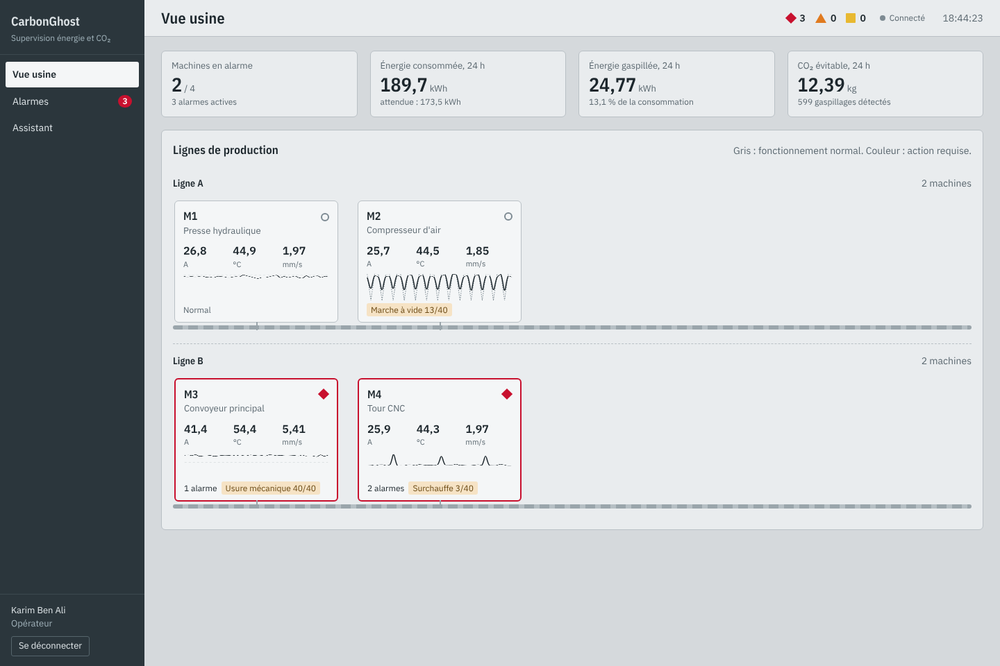
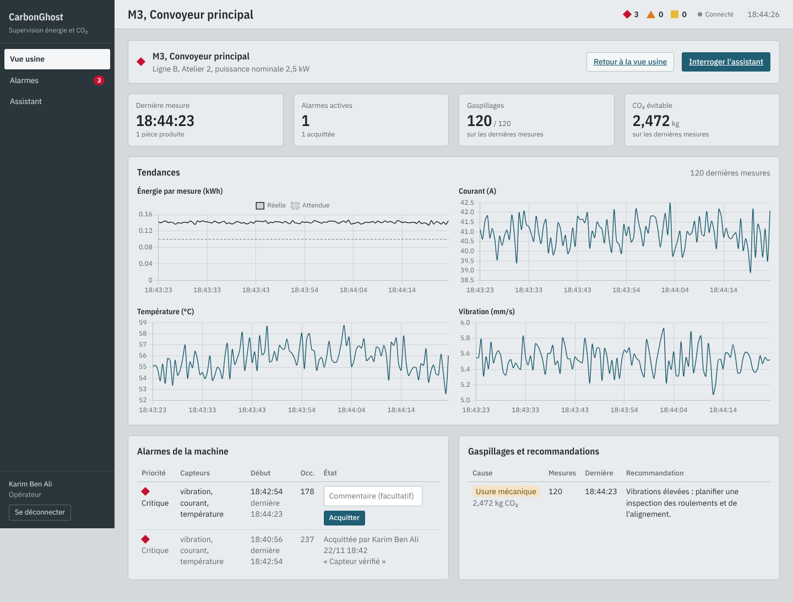
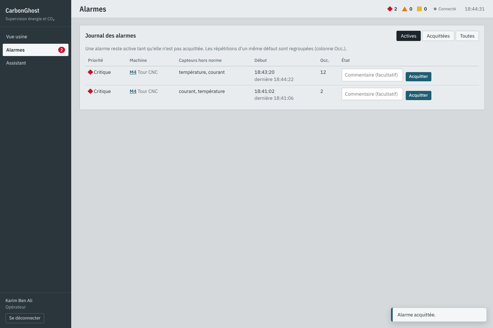
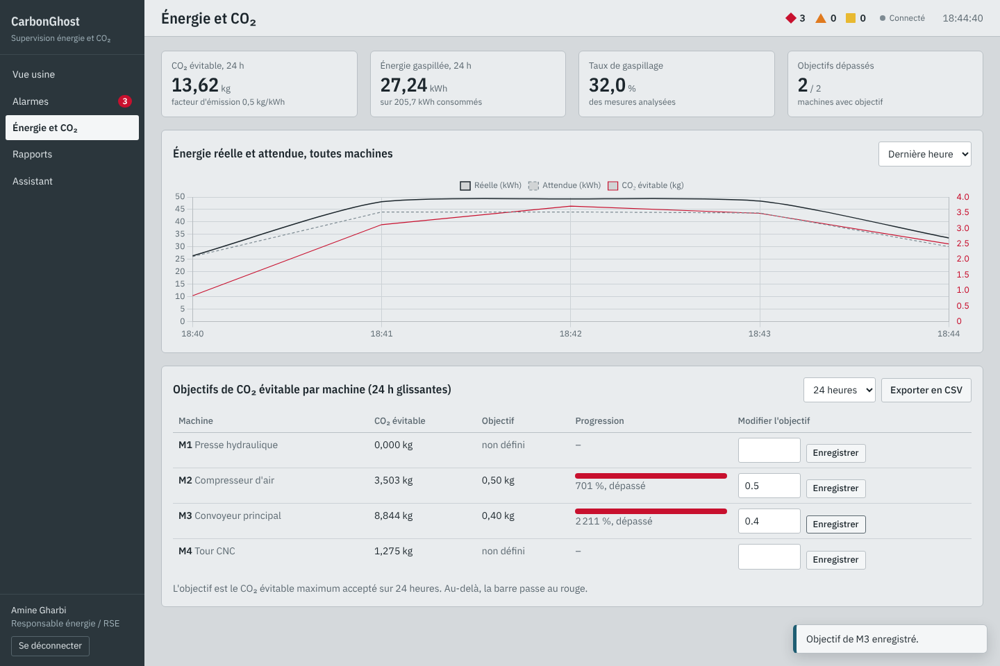

# CarbonGhost Sentinel

Supervision énergie et CO₂ pour l'industrie : mesures capteurs en temps réel, détection d'anomalies, gestion des alarmes, objectifs carbone et rapports, avec un accès par rôle.



## Fonctionnalités

- **Vue usine** : lignes de production et machines en style salle de contrôle (gris = normal, couleur = action requise).
- **Fiche machine** : tendances énergie, courant, température, vibration ; gaspillages regroupés par cause avec recommandation.
- **Alarmes** : priorités critique / haute / moyenne, regroupement des répétitions, acquittement avec commentaire et historique.
- **Détection** : z-score glissant avec temporisation (moins de fausses alarmes) et détection de dérive lente (usure).
- **Énergie et CO₂** : énergie réelle vs attendue, objectifs par machine, export CSV.
- **Rapports** : générés à la demande ou automatiquement toutes les 24 h, archivés.
- **Assistant** : questions en langage naturel sur les machines (IA Groq optionnelle).
- **Connexion et rôles** : JWT, permissions vérifiées par chaque microservice.

## Lancer le projet

Prérequis : [Docker Desktop](https://www.docker.com/products/docker-desktop/).

```bash
git clone <url-du-depot>
cd CarbonGhost
cp env.example .env        # Windows : copy env.example .env
docker compose up --build
```

Ouvrir **http://localhost:8080**. Le simulateur envoie des mesures pour 4 machines (M1 normale, M2 marche à vide, M3 usure progressive, M4 surchauffes) et l'interface se remplit en quelques secondes. La documentation de chaque API est sur http://localhost:8001/docs à http://localhost:8006/docs.

### Comptes de démonstration

Mot de passe : `demo1234`

| Compte | Rôle | Accès |
|---|---|---|
| operateur@carbonghost.com | Opérateur | Vue usine, alarmes (acquittement), assistant |
| chef.ligne@carbonghost.com | Chef de ligne | + énergie et CO₂ |
| energie@carbonghost.com | Responsable énergie / RSE | Énergie, objectifs, rapports, export CSV |
| admin.demo@carbonghost.com | Administrateur | Tout, dont machines et utilisateurs |

Optionnel : ajouter une clé gratuite [Groq](https://console.groq.com/keys) dans `.env` (`GROQ_API_KEY=...`) pour des réponses rédigées par une IA. Sans clé, l'assistant répond à partir des données.

### Services

| Service | Port | Rôle |
|---|---|---|
| service-user | 8001 | Comptes, connexion JWT, rôles et permissions |
| service-carbone | 8002 | Énergie réelle vs attendue, CO₂ évitable, objectifs, export |
| service-mesures | 8003 | Reçoit les mesures MQTT, les enregistre et les publie sur Kafka |
| service-ia | 8004 | Détection d'anomalies et gestion des alarmes |
| service-assistant | 8005 | Questions en langage naturel et rapports |
| service-factory | 8006 | Machines et lignes de production |
| dashboard | 8080 | Interface web |
| simulator | | Remplace les capteurs ESP32 et la passerelle |

```
simulateur ──MQTT──▶ service-mesures ──Kafka measures.raw──▶ service-carbone ──Kafka carbon.events──▶ service-assistant
                                                     └──────▶ service-ia ──Kafka alerts
```

| Fiche machine | Alarmes | Énergie et CO₂ |
|---|---|---|
|  |  |  |

## Principe

Une machine peut consommer plus d'énergie que sa production ne le justifie : marche à vide, mauvais réglage, usure. CarbonGhost compare en continu l'énergie réelle à l'énergie attendue et transforme chaque écart en information utile :

```
mesure capteur → écart détecté → CO₂ évitable → cause probable → action recommandée
```

Architecture détaillée : [docs/ARCHITECTURE.md](docs/ARCHITECTURE.md).
